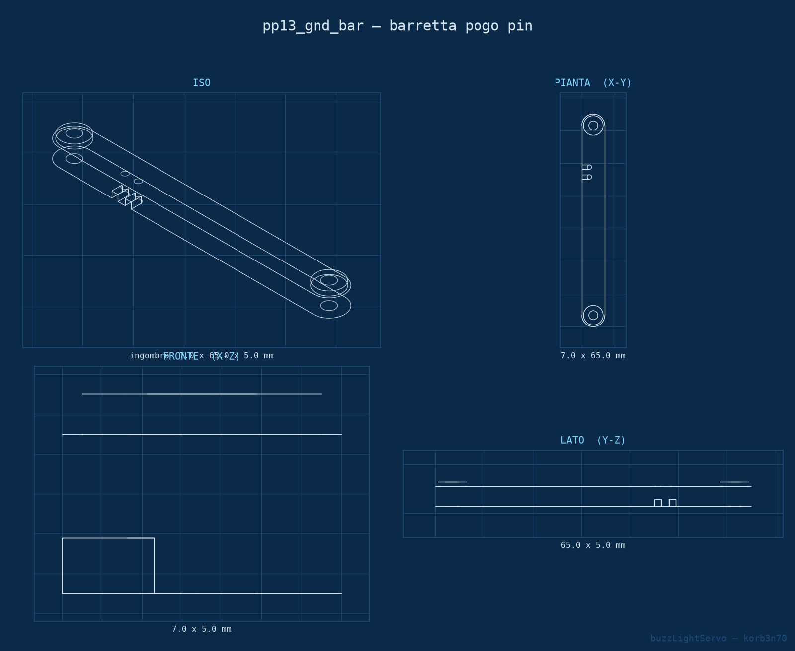
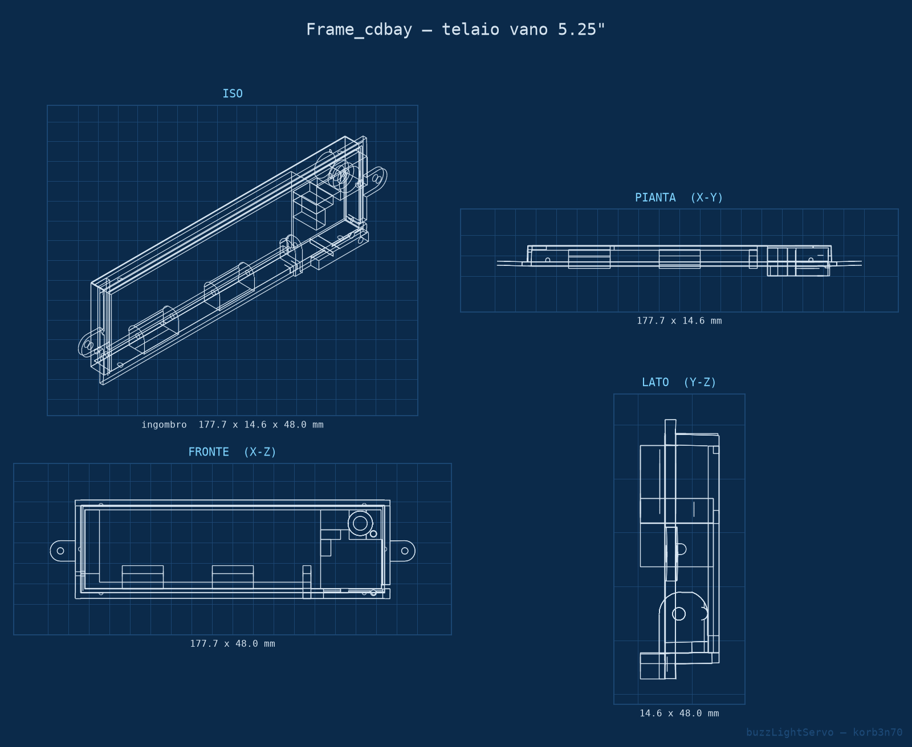
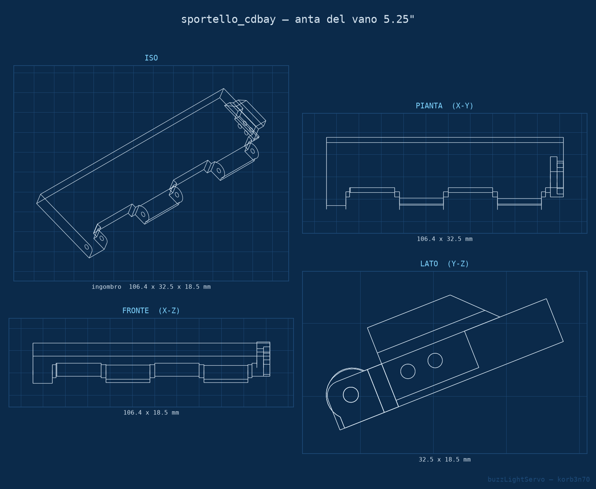
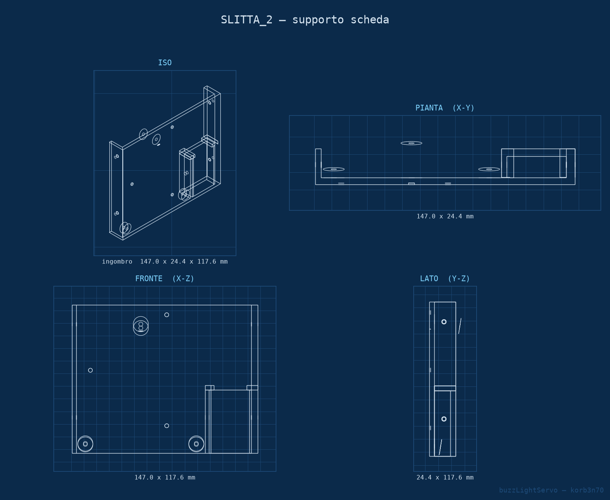

Quando sostituisci l'hard disk meccanico di un **Amiga 2000** con qualcosa di moderno — una
scheda SCSI **A2091** con storage a stato solido, oppure un **PiStorm2K** con Raspberry Pi — la
macchina diventa silenziosa. È un guadagno, ma si perde qualcosa: il ticchettio e il LED che
per anni hanno detto, senza bisogno di guardare lo schermo, che il computer stava lavorando.

**buzzLightServo** rimette quel feedback al suo posto, e già che c'è motorizza lo sportello del
vano da 5.25".

<!-- TODO: link al repository quando il sorgente diventa pubblico -->
<!-- TODO: immagine di apertura in /assets/img/posts/buzzlightservo.jpg -->

## Cosa fa

- **Suono dell'hard disk** — un buzzer riproduce i tac e le raffiche di ricerca, sincronizzati
  con l'attività disco reale
- **LED di attività** — pilota il LED HD originale del case
- **Sportello motorizzato** — un servo SG90 apre e chiude l'anta del vano 5.25" alla pressione
  di un pulsante, per arrivare alla microSD del Pi senza smontare mezzo computer

Il segnale di attività viene letto direttamente dall'hardware, senza patch software né driver.

## Due sorgenti, due problemi diversi

La parte interessante è proprio qui: le due sorgenti di attività non si assomigliano per niente.

L'**A2091** offre un'uscita LED a 5V, quindi un segnale digitale pulito. L'unica accortezza è
l'isolamento: passa attraverso un **optoaccoppiatore PC817**, così tra il controller dell'Amiga
e il microcontrollore non scorre corrente, solo luce.

Il **Raspberry Pi** invece non offre niente di simile. Il segnale si preleva dal test point
**PP13** con due pogo pin tenuti in posizione da una barretta stampata in 3D, senza saldare
nulla sulla scheda. E quel segnale è analogico, ballerino, diverso da macchina a macchina.


_La barretta che tiene i pogo pin sui test pad del Pi: 7 × 65 × 5 mm, due viti M2.5 nei fori
già presenti sulla scheda._

## Il bug che si sente

Qui è arrivata la sorpresa che mi ha fatto rifare la logica. Misurando PP13 sull'ADC del Nano
saltano fuori **tre** stati, non due:

| Stato del Pi | Valore letto |
|---|---|
| Spento | ~0 |
| Attività | ~118 – 382 |
| Acceso ma fermo | ~631 |

Con una soglia singola — "sotto tot è attività" — il Pi **spento** finisce nella stessa
casella dell'attività, perché sta anche lui in basso. Risultato: a computer acceso e Pi spento,
il buzzer ticchetta all'impazzata simulando un disco che non esiste.

La soluzione è leggere una **finestra** invece di una soglia: è attività solo se il valore sta
*tra* due limiti, escludendo sia lo zero dello spento sia il valore alto del riposo.

```
    0 ─────── PI_MIN ═══ ATTIVITÀ ═══ PI_SOGLIA ─────── 1023
    │                                          │
  spento                                    riposo
```

Intorno ai bordi c'è un margine di isteresi, e ogni lettura è la media di otto campioni:
senza, il valore che oscilla sulla soglia fa sfarfallare LED e buzzer.

## Due versioni della scheda

<!-- TODO: foto delle due schede -->

La prima versione usava una **Digispark ATtiny85**: compatta, sufficiente per l'A2091, ma con
cinque pin in tutto e tutti occupati. Nessuno spazio per leggere anche il Pi.

La versione definitiva è su **Arduino Nano**: legge entrambe le sorgenti in parallelo, senza
jumper da commutare, con debug seriale via USB. Nel PCB v2.1 ho lasciato una comodità che
consiglio a chiunque monti qualcosa dentro un case chiuso: un cavo USB che esce dal vano 5.25"
e resta collegato al Nano. Diventa una porta di servizio permanente per riprogrammare e leggere
il monitor seriale senza smontare niente.

## Le parti stampate

Tre gruppi, disegnati in Fusion 360:

- la **barretta pogo pin** che preleva PP13 e la massa dal Pi senza saldature
- il **telaio, l'anta e la staffa del servo** del vano 5.25"
- la **slitta** che porta il PCB dentro il vano, fissata con le viti laterali già previste dal
  case


_Il telaio che occupa il vano da 5.25" e porta il servo: 177,7 × 14,6 × 48,0 mm._


_L'anta incernierata, mossa dal braccetto del servo._


_La slitta che porta il PCB dentro il vano, fissata con le quattro viti laterali già previste
dal case._

L'anta è l'unico pezzo in PLA, verniciato a smalto opaco nel tono scuro dell'Amiga: è la sola
parte a vista. Tutto il resto è PETG, che sopporta meglio il calore dentro il case. Tutti i
pezzi si stampano a 0,16 mm; solo la slitta richiede supporti.

## Com'è finita

Il progetto è chiuso: PCB v2.1, firmware v2.2, collaudato sull'hardware reale.

A un certo punto avevo in programma un'autocalibrazione con salvataggio delle soglie in EEPROM,
da lanciare tenendo premuto il pulsante. Con la lettura a finestra non serve più: i tre livelli
del Pi sono abbastanza distanti tra loro da rendere i valori predefiniti validi senza
ritocchi. Una funzione in meno da scrivere, da documentare e da spiegare a chi replica il
progetto — il modo migliore di risolvere un problema resta farlo sparire.

Il ticchettio è tornato. Finto, certo: ma l'orecchio non fa differenza, e alla fine è quello
che conta.

<!-- TODO: video -->

---

*Bozza — prima di pubblicare: aggiungere il link al repository, le foto delle due schede, una
foto del montaggio reale nel case e il video. Poi impostare il campo `date` e spostare il file
in `_posts/`.*
