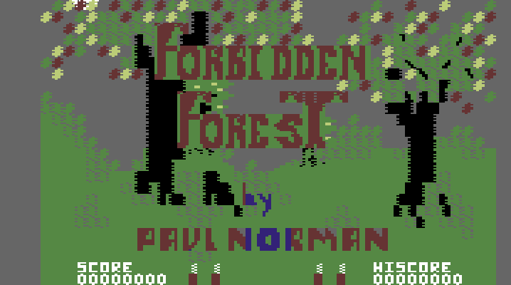
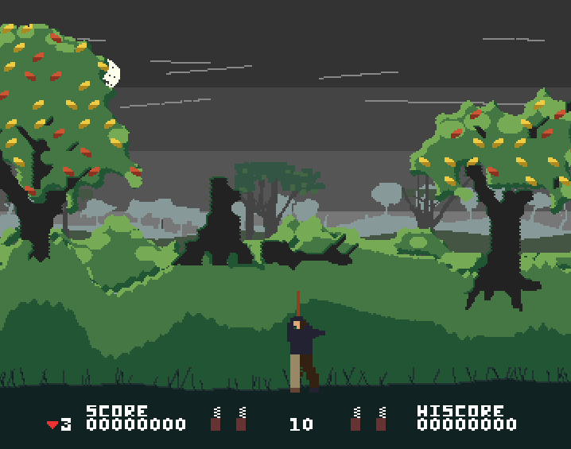
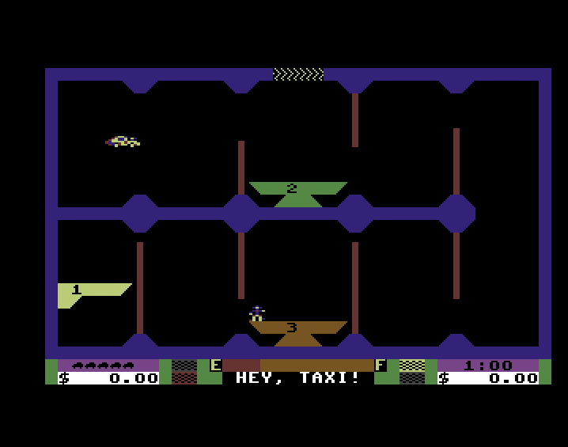
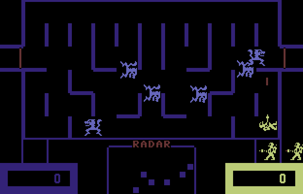
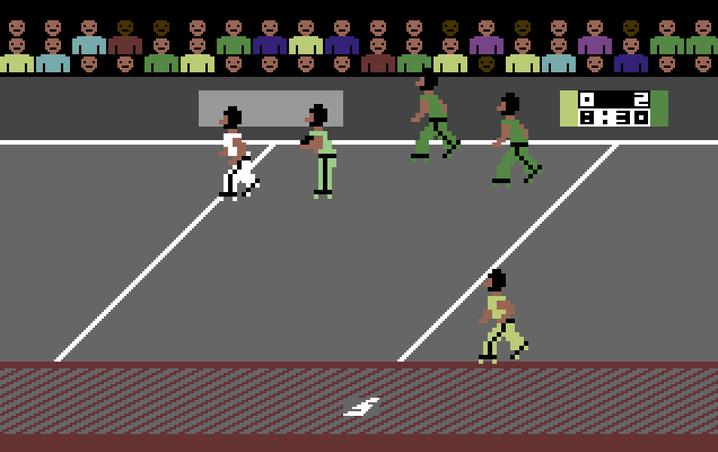
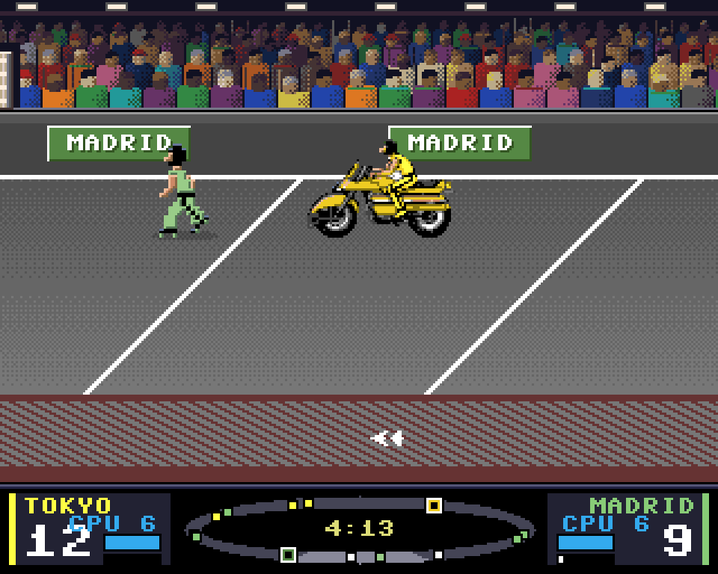
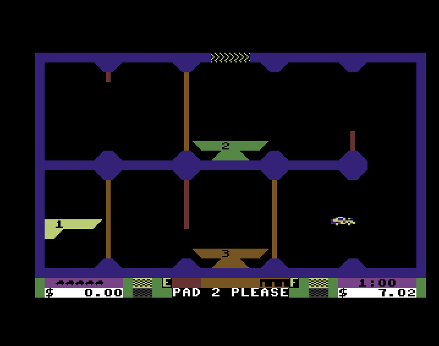

Retro-ingegneria · Commodore 64 → Amiga

  
Massimo Bonomo · 3 novembre 2026 · Forbidden Forest, Wizard of Wor, Space Taxi, Rocketball

  <figure class="wide">
    

      
Forbidden Forest · edizione Fast, grafica del C64

      
Forbidden Forest · edizione Remake

    

    <figcaption>Lo stesso codice di gioco, tradotto dal 6502 del C64, su Amiga in WinUAE. A sinistra la grafica originale, a destra il Remake.</figcaption>
  </figure>

  
Molti pensano che oggi basti scrivere a un'IA «converti questo gioco del C64 per Amiga» e aspettare. Non funziona così. Un gioco del 1983 è un intreccio di codice macchina, tempi contati al ciclo e trucchi sull'hardware, e ogni trucco va capito prima di poterlo rifare su una macchina diversa.

  
Per questo ho costruito <b>reforge</b>, un framework che parte dal codice originale del Commodore 64 e lo trasforma in un programma portabile, verificato pezzo per pezzo contro l'originale. L'IA lavora dentro questo processo: analizza, scrive codice, lancia prove, misura. Le decisioni restano mie.

  <h2>Perché questa strada</h2>
  
Le mie prime conversioni, le versioni 1.x, ricompilavano il 6502 direttamente in assembler 68000. Sono velocissime anche su un A500 di serie, ma restano legate all'Amiga e a un codice che solo pochi sanno leggere.

  
reforge è una scelta voluta: tradurre il gioco in C portabile, separato dall'hardware, significa poterlo <b>portare su piattaforme moderne</b> cambiando solo lo strato che parla con la macchina, e poterlo <b>moddare con un linguaggio d'alto livello</b>. Chi vuole cambiare un livello, aggiungere un power-up o rifare la grafica lavora su funzioni C leggibili, non su listati del 6502. L'Amiga è la prima piattaforma, non l'unica.

  <h2>Il metodo in un colpo d'occhio</h2>
  <figure class="wide">
    

      <svg viewBox="0 0 640 784" role="img" aria-label="Flusso di reforge: dal programma C64 all'analisi, alla descrizione del gioco, alla traduzione in C, alla verifica contro l'oracolo, poi alle HAL Amiga e PC, alle prove in WinUAE, ai pacchetti e ad AmiSync che li porta sull'Amiga vero; dal ramo PC le piattaforme moderne e le mod in C">
        <defs>
          <marker id="ah" viewBox="0 0 10 10" refX="9" refY="5" markerWidth="7" markerHeight="7" orient="auto"><path class="head" d="M0,0 L10,5 L0,10 z"/></marker>
          <marker id="ak" viewBox="0 0 10 10" refX="9" refY="5" markerWidth="7" markerHeight="7" orient="auto"><path class="headk" d="M0,0 L10,5 L0,10 z"/></marker>
        </defs>
        <rect class="box k" x="150" y="10" width="300" height="56" rx="6"/>
        <text x="300" y="34" text-anchor="middle" class="strong">Programma originale del C64</text>
        <text x="300" y="53" text-anchor="middle" class="small">codice 6502 e memoria, come gira sul C64</text>
        <path class="arrow" d="M300,66 V92" marker-end="url(#ah)"/>
        <rect class="box" x="150" y="94" width="300" height="56" rx="6"/>
        <text x="300" y="118" text-anchor="middle" class="strong">1 · Analisi</text>
        <text x="300" y="137" text-anchor="middle" class="small">routine, dati, attese su schermo e musica</text>
        <path class="arrow" d="M300,150 V176" marker-end="url(#ah)"/>
        <rect class="box" x="150" y="178" width="300" height="56" rx="6"/>
        <text x="300" y="202" text-anchor="middle" class="strong">2 · Descrizione del gioco</text>
        <text x="300" y="221" text-anchor="middle" class="small">game.json: cosa fa ogni routine</text>
        <path class="arrow" d="M300,234 V260" marker-end="url(#ah)"/>
        <rect class="box" x="150" y="262" width="300" height="56" rx="6"/>
        <text x="300" y="286" text-anchor="middle" class="strong">3 · Traduzione</text>
        <text x="300" y="305" text-anchor="middle" class="small">reforge lift: 6502 → C portabile</text>
        <path class="arrow" d="M300,318 V344" marker-end="url(#ah)"/>
        <rect class="box k" x="150" y="346" width="300" height="56" rx="6"/>
        <text x="300" y="370" text-anchor="middle" class="strong">4 · Verifica</text>
        <text x="300" y="389" text-anchor="middle" class="small">routine per routine, fotogramma per fotogramma</text>
        <rect class="box k" x="478" y="346" width="152" height="56" rx="6"/>
        <text x="554" y="370" text-anchor="middle" class="strong lk">Oracolo</text>
        <text x="554" y="389" text-anchor="middle" class="small">esegue il 6502 originale</text>
        <path class="arrow" d="M452,374 H476" marker-end="url(#ah)"/>
        <path class="loop" d="M150,374 H70 V122 H146" marker-end="url(#ak)"/>
        <text x="62" y="250" text-anchor="middle" class="small lk" transform="rotate(-90 62 250)">diverso? si torna all'analisi</text>
        <path class="arrow" d="M260,402 V440 H170 V458" marker-end="url(#ah)"/>
        <path class="arrow" d="M340,402 V440 H430 V458" marker-end="url(#ah)"/>
        <rect class="box a" x="80" y="460" width="180" height="56" rx="6"/>
        <text x="170" y="484" text-anchor="middle" class="strong la">HAL Amiga</text>
        <text x="170" y="503" text-anchor="middle" class="small">grafica, Paula, joystick</text>
        <rect class="box" x="340" y="460" width="180" height="56" rx="6"/>
        <text x="430" y="484" text-anchor="middle" class="strong">HAL PC</text>
        <text x="430" y="503" text-anchor="middle" class="small">prove veloci e automatiche</text>
        <path class="arrow" d="M170,516 V542" marker-end="url(#ah)"/>
        <rect class="box a" x="40" y="544" width="260" height="56" rx="6"/>
        <text x="170" y="568" text-anchor="middle" class="strong">5 · Prove in WinUAE</text>
        <text x="170" y="587" text-anchor="middle" class="small">A500, A1200, PiStorm, WHDLoad</text>
        <path class="arrow" d="M170,600 V626" marker-end="url(#ah)"/>
        <rect class="box a" x="40" y="628" width="260" height="56" rx="6"/>
        <text x="170" y="652" text-anchor="middle" class="strong">6 · Pacchetti</text>
        <text x="170" y="671" text-anchor="middle" class="small">dischetto avviabile, WHDLoad, .lha</text>
        <path class="arrow" d="M170,684 V710" marker-end="url(#ah)"/>
        <rect class="box a" x="40" y="712" width="260" height="56" rx="6"/>
        <text x="170" y="736" text-anchor="middle" class="strong la">7 · AmiSync</text>
        <text x="170" y="755" text-anchor="middle" class="small">release → rete → Amiga vero</text>
        <path class="arrow" d="M430,516 V542" marker-end="url(#ah)"/>
        <rect class="box" x="340" y="544" width="180" height="56" rx="6"/>
        <text x="430" y="568" text-anchor="middle" class="strong">Piattaforme moderne</text>
        <text x="430" y="587" text-anchor="middle" class="small">e mod scritte in C</text>
      </svg>
    

    <figcaption>Il gioco tradotto non viene mai accettato «perché sembra giusto»: deve fare esattamente quello che fa il codice originale.</figcaption>
  </figure>

  <h3>1 · Analisi</h3>
  
Si parte dal codice macchina del C64. Ogni routine viene studiata: cosa legge, cosa scrive, quando aspetta il pennello dello schermo, quando parla con il chip audio. Alcuni giochi modificano il proprio codice mentre girano, o nascondono variabili in mezzo alle istruzioni. Space Taxi lo fa in ventisei zone diverse della memoria.

  <h3>2 · Descrizione e 3 · Traduzione</h3>
  
Quello che emerge dall'analisi finisce in una descrizione del gioco, <code>game.json</code>. Da lì il traduttore di reforge genera C portabile, senza nulla di specifico per l'Amiga: lo stesso codice gira anche sul PC.

  <h3>4 · Verifica contro l'oracolo</h3>
  
È il cuore del metodo. Un emulatore, che chiamo <b>oracolo</b>, esegue il codice originale del 6502 istruzione per istruzione. Il gioco tradotto viene confrontato con lui su ogni routine e su ogni fotogramma: stessi valori in memoria, stessi suoni avviati, stesse immagini, confrontate al pixel anche con l'emulatore C64 VICE. Se qualcosa non torna, si torna all'analisi. Le prove girano sul PC perché lì sono veloci, ma il termine di paragone è sempre il C64.

  <h3>5 · Prove e 6 · Pacchetti</h3>
  
Poi l'Amiga: la parte che parla con l'hardware (la <b>HAL</b>) traduce grafica, suono e input. Le prove girano in WinUAE su configurazioni diverse, compresa una partita automatica di oltre un'ora per controllare che non si perda nemmeno un fotogramma. Alla fine ogni edizione esce come dischetto avviabile, cartella WHDLoad e archivio <code>.lha</code>.

  <h3>7 · AmiSync: dal PC all'Amiga vero</h3>
  
L'emulatore non basta: alla fine il gioco va provato su un Amiga vero. Per non passare ogni volta da dischetti e chiavette ho scritto <b>AmiSync</b>. Quando pubblico una versione su GitHub, anche una versione di prova, AmiSync la scarica sul NAS di casa e la porta via rete sul mio Amiga con PiStorm, già installata come pacchetto WHDLoad. Tra «versione pronta» e «ci sto giocando» passano pochi minuti, e i test sull'hardware vero diventano un'abitudine invece che un evento.

  
AmiSync impone anche delle regole ai progetti: un solo numero di versione, lo stesso nel nome dei file, nel programma e sullo schermo; pacchetti con nomi stabili; mai file rinominati tra una versione e l'altra. Sono regole che fanno bene anche a chi scarica i giochi.

  <h2>Due computer, due filosofie</h2>
  
Sulla carta l'Amiga è molto più potente del C64. In pratica deve imitare un hardware costruito con idee diverse, chip per chip.

  <figure class="wide">
    

      <svg viewBox="0 0 680 370" role="img" aria-label="Corrispondenza tra i chip del C64 e quelli dell'Amiga, con il lavoro della HAL in mezzo">
        <defs><marker id="ah2" viewBox="0 0 10 10" refX="9" refY="5" markerWidth="7" markerHeight="7" orient="auto"><path class="head" d="M0,0 L10,5 L0,10 z"/></marker></defs>
        <text x="95" y="20" text-anchor="middle" class="strong lk">Commodore 64</text>
        <text x="340" y="20" text-anchor="middle" class="strong">cosa fa reforge</text>
        <text x="585" y="20" text-anchor="middle" class="strong la">Amiga</text>
        <g>
          <rect class="box k" x="10" y="36" width="170" height="54" rx="6"/><text x="95" y="59" text-anchor="middle" class="strong">CPU 6510</text><text x="95" y="77" text-anchor="middle" class="small">1 MHz, 8 bit</text>
          <path class="arrow" d="M184,63 H496" marker-end="url(#ah2)"/><text x="340" y="56" text-anchor="middle" class="small">C tradotto, flag del 6502 riprodotti</text>
          <rect class="box a" x="500" y="36" width="170" height="54" rx="6"/><text x="585" y="59" text-anchor="middle" class="strong">68000 / 68020</text><text x="585" y="77" text-anchor="middle" class="small">7 MHz e oltre</text>
        </g>
        <g>
          <rect class="box k" x="10" y="102" width="170" height="54" rx="6"/><text x="95" y="125" text-anchor="middle" class="strong">VIC-II</text><text x="95" y="143" text-anchor="middle" class="small">caratteri, sprite, raster</text>
          <path class="arrow" d="M184,129 H496" marker-end="url(#ah2)"/><text x="340" y="122" text-anchor="middle" class="small">disegno rifatto, collisioni sulla CPU</text>
          <rect class="box a" x="500" y="102" width="170" height="54" rx="6"/><text x="585" y="125" text-anchor="middle" class="strong">Agnus · Denise</text><text x="585" y="143" text-anchor="middle" class="small">bitplane, sprite, copper</text>
        </g>
        <g>
          <rect class="box k" x="10" y="168" width="170" height="54" rx="6"/><text x="95" y="191" text-anchor="middle" class="strong">SID 6581</text><text x="95" y="209" text-anchor="middle" class="small">sintetizzatore, 3 voci</text>
          <path class="arrow" d="M184,195 H496" marker-end="url(#ah2)"/><text x="340" y="188" text-anchor="middle" class="small">suono risintetizzato in campioni</text>
          <rect class="box a" x="500" y="168" width="170" height="54" rx="6"/><text x="585" y="191" text-anchor="middle" class="strong">Paula</text><text x="585" y="209" text-anchor="middle" class="small">4 canali di campioni, 8 bit</text>
        </g>
        <g>
          <rect class="box k" x="10" y="234" width="170" height="54" rx="6"/><text x="95" y="257" text-anchor="middle" class="strong">2 × CIA 6526</text><text x="95" y="275" text-anchor="middle" class="small">tastiera, joystick, timer</text>
          <path class="arrow" d="M184,261 H496" marker-end="url(#ah2)"/><text x="340" y="254" text-anchor="middle" class="small">tasti e joystick rimappati</text>
          <rect class="box a" x="500" y="234" width="170" height="54" rx="6"/><text x="585" y="257" text-anchor="middle" class="strong">2 × CIA 8520</text><text x="585" y="275" text-anchor="middle" class="small">tastiera, porte, timer</text>
        </g>
        <g>
          <rect class="box k" x="10" y="300" width="170" height="54" rx="6"/><text x="95" y="323" text-anchor="middle" class="strong">64 KB di RAM</text><text x="95" y="341" text-anchor="middle" class="small">tutto in uno spazio</text>
          <path class="arrow" d="M184,327 H496" marker-end="url(#ah2)"/><text x="340" y="320" text-anchor="middle" class="small">dati compressi, memoria chip contata</text>
          <rect class="box a" x="500" y="300" width="170" height="54" rx="6"/><text x="585" y="323" text-anchor="middle" class="strong">512 KB chip</text><text x="585" y="341" text-anchor="middle" class="small">+ memoria fast, dischetti 880 KB</text>
        </g>
      </svg>
    

  </figure>

  <h2>La sfida più bella: il SID contro Paula</h2>
  
Il chip audio del C64, il SID, è un vero sintetizzatore: tre voci con oscillatori, inviluppi, un filtro analogico, modulazione ad anello e rumore. Paula, il chip audio dell'Amiga, fa un'altra cosa: suona campioni a 8 bit su quattro canali. Non può «suonare» le istruzioni del SID. Il suono va ricostruito.

  
Per le musiche lo strumento <b>sid2paula</b> trasforma ciò che il SID produrrebbe in flussi di campioni che Paula può riprodurre. Per gli effetti la HAL traduce in tempo reale i registri del SID. Ogni suono lo confronto a orecchio, originale contro Amiga. Ascoltate voi.

  

    

<b>Musica di Space Taxi</b><small>brano 8 del gioco, primi 15 secondi · C64 = SID emulato con reSID</small>

      
<button data-src="/assets/audio/reforge/mus_c64.wav">C64</button><button class="am" data-src="/assets/audio/reforge/mus_ami.wav">Amiga</button>

    

<b>Motore ed effetti</b><small>12 secondi della demo: il rumore del motore è la terza voce del SID, accesa e spenta mentre si dà spinta</small>

      
<button data-src="/assets/audio/reforge/eng_c64.wav">C64</button><button class="am" data-src="/assets/audio/reforge/eng_ami.wav">Amiga</button>

    

<b>«Hey, taxi!»</b><small>la voce originale, estratta dal C64 e rifatta come campione per Paula</small>

      
<button data-src="/assets/audio/reforge/voc_c64.wav">C64</button><button class="am" data-src="/assets/audio/reforge/voc_ami.wav">Amiga</button>

  

  
Anche i difetti contano. Il SID 6581 è in parte analogico: quando un gioco cambia il volume si sente un «clic», e un filo di rumore passa anche a voce spenta. Nelle registrazioni del C64 di Space Taxi c'è un fondo leggero nei primi venti secondi: l'abbiamo analizzato e non è un suono del gioco, è il chip che «trapela». Sull'Amiga lì c'è silenzio, ed è giusto così.

  
Le voci di Space Taxi sono un trucco geniale del 1984: il C64 non ha un campionatore, e il gioco «parla» scrivendo velocissimo nel registro del volume del SID, quattro bit alla volta. Per l'Amiga le ho estratte da lì e trasformate in campioni veri.

  <h2>Grafica e tempi: precisione al pixel</h2>
  <figure class="wide">
    

      
Space Taxi su Amiga · «Hey, taxi!»

      
Wizard of Wor su Amiga · edizione Fast

    

    <figcaption>Le immagini del titolo e della demo di Space Taxi sono identiche al pixel a quelle dell'originale. Lo scorrimento di Wizard of Wor è identico a quello dell'emulatore C64 VICE.</figcaption>
  </figure>
  
Il chip grafico del C64, il VIC-II, ha sprite hardware che segnalano da soli quando si toccano, scorrimento fine dello schermo e interrupt legati alla riga del pennello. L'Amiga lavora per piani di bit: molte cose vanno rifatte, e le collisioni tra sprite le calcola il processore.

  
Poi ci sono i tempi. I giochi del C64 sono sincronizzati con lo schermo e con la musica, cinquanta volte al secondo. Basta uno scarto minimo e il gioco cambia: in Wizard of Wor un ciclo che non contava il proprio tempo faceva girare tutto il 18% più veloce del dovuto. Nessuno l'avrebbe notato a occhio. L'ha notato la misura.

  <h2>Il paradosso del 68000</h2>
  
Un 68000 a 7 MHz batte un 6502 a 1 MHz, giusto? Non quando deve imitarlo esattamente. Il codice tradotto deve riprodurre ogni dettaglio del 6502, compresi i flag del processore dopo ogni operazione, e su un A500 di serie questo costa caro.

  <figure class="wide">
    

      <svg viewBox="0 0 640 230" role="img" aria-label="Velocità su A500 di serie: Wizard of Wor dal 45 al 70 per cento, Space Taxi dal 7 al 17 per cento, port 1.x al 100 per cento">
        <!-- scala: 0% a x=190, 100% a x=610 (4,2 px per punto) -->
        <g class="small">
          <line x1="190" y1="18" x2="190" y2="196" stroke="var(--line)"/><line x1="295" y1="18" x2="295" y2="196" stroke="var(--line)"/>
          <line x1="400" y1="18" x2="400" y2="196" stroke="var(--line)"/><line x1="505" y1="18" x2="505" y2="196" stroke="var(--line)"/>
          <line x1="610" y1="18" x2="610" y2="196" stroke="var(--line)"/>
          <text x="190" y="214" text-anchor="middle" class="small">0%</text><text x="295" y="214" text-anchor="middle" class="small">25%</text>
          <text x="400" y="214" text-anchor="middle" class="small">50%</text><text x="505" y="214" text-anchor="middle" class="small">75%</text>
          <text x="610" y="214" text-anchor="middle" class="small">100%</text>
        </g>
        <text x="180" y="40" text-anchor="end" class="strong">Wizard of Wor</text><text x="180" y="56" text-anchor="end" class="small">prima / dopo</text>
        <rect x="190" y="26" width="189" height="14" fill="var(--line)"/><text x="385" y="38" class="small">45%</text>
        <rect x="190" y="44" width="294" height="14" fill="var(--c64)"/><text x="490" y="56" class="small">70%</text>
        <text x="180" y="100" text-anchor="end" class="strong">Space Taxi</text><text x="180" y="116" text-anchor="end" class="small">prima / dopo</text>
        <rect x="190" y="86" width="29" height="14" fill="var(--line)"/><text x="225" y="98" class="small">7%</text>
        <rect x="190" y="104" width="71" height="14" fill="var(--c64)"/><text x="267" y="116" class="small">17%</text>
        <text x="180" y="166" text-anchor="end" class="strong">Port 1.x</text><text x="180" y="182" text-anchor="end" class="small">6502 → asm 68000</text>
        <rect x="190" y="160" width="420" height="14" fill="var(--amiga)"/><text x="604" y="190" text-anchor="end" class="small">100%</text>
      </svg>
    

    <figcaption>Velocità del gioco su un A500 di serie (68000 a 7 MHz), in percentuale di quella del C64, misurata in WinUAE. «Dopo» = con le ottimizzazioni generali del traduttore.</figcaption>
  </figure>
  
Le misure dicono esattamente dove va il tempo. In Space Taxi più di metà se ne andava in una sola funzione: cercava dove stesse un dato in memoria confrontando fino a ottanta posizioni una dopo l'altra, perché il gioco tiene le sue variabili sparse in ventisei zone diverse. Sostituirla con una tabella diretta dovrebbe più che raddoppiare la velocità. Ma per arrivare al 100% su un A500 serve un passo in più: tradurre direttamente in assembler 68000, come fanno già le mie versioni 1.x. Sugli Amiga accelerati, dal 68020 al PiStorm, le edizioni reforge girano già a piena velocità.

  
C'è però un seguito, ed è la scoperta più utile di questi giorni: <b>il collo di bottiglia non è il C</b>. Su A1200 e su 68030 la logica tradotta va alla velocità giusta, senza perdere fotogrammi; il tempo se ne va nel <b>disegno dello schermo</b>. reforge ricostruisce lo schermo del C64 come farebbe un emulatore, carattere per carattere, allo stesso modo per tutti i giochi: lo scorrimento del bosco di Forbidden Forest ne cambia quasi tutto a ogni passo, e su un A1200 di serie restano circa otto immagini al secondo. La 1.x di Forbidden Forest, invece, ha un display scritto apposta per quel gioco, che usa lo scorrimento hardware dell'Amiga: va veloce per questo, non per l'assembly in sé. Il C costa davvero solo sull'A500, dove il 68000 non regge la logica tradotta con i flag del 6502 al seguito. Sapere dove si perde il tempo cambia il lavoro: la prossima mossa non è riscrivere il gioco in assembler, è dare a ogni gioco il disegno che gli serve.

  <h2>Rocketball: tutto da reforge, anche l'A500</h2>
  <figure class="wide">
    

      
Rocketball · grafica originale

      
Rocketball · Remake, con la moto

    

    <figcaption>Rocketball su Amiga: a sinistra l'edizione originale, a destra il Remake con pubblico ridisegnato, tabellone nuovo e la moto come power-up.</figcaption>
  </figure>
  
Rocketball è il primo gioco uscito interamente da reforge: la versione 2.0 è pubblicata con tre edizioni, originale per A500 di serie, originale per Amiga accelerati e Remake. È un gioco più leggero degli altri, e sull'A500 di serie il gioco tiene la velocità del C64; lo schermo disegna meno immagini al secondo, ma la partita non rallenta. Il Remake è l'esempio di cosa significa moddare in C: annunciatore, pubblico, tabellone e moto sono aggiunte scritte sopra il gioco originale tradotto.

  <h2>Memoria e dischetti</h2>
  
512 KB di memoria chip, dischetti da 880 KB. Suoni, musiche e voci vengono compressi dentro il programma, e il programma che prepara la release si ferma con un errore se un'edizione non ha il suo dischetto avviabile. È una regola nata da un errore vero: una prima versione del Remake di Space Taxi era uscita senza dischetto, «troppo grande». Compresso, ci sta.

  <h2>Il Remake: voci nuove, scelte a orecchio</h2>
  
Per il Remake di Space Taxi ho voluto voci di qualità più alta ma con lo stesso tono del gioco: voce maschile alzata, come un cliente che chiama un taxi dal marciapiede. Sono state generate tre voci con sintesi vocale, portate alla stessa altezza dell'originale (circa 205 Hz), con la stessa durata delle parole e un po' di «colore» da altoparlante. Le ho ascoltate al telefono, una contro l'altra, e ho scelto Ryan.

  <figure class="wide">
    

      
Space Taxi Remake · «Pad 2, please»

      

        

<b>«Hey, taxi!»</b><small>originale C64 e Remake</small>

          
<button data-src="/assets/audio/reforge/voc_c64.wav">C64</button><button class="am" data-src="/assets/audio/reforge/voc_ryan.wav">Remake</button>

        

<b>«Pad 2, please»</b><small>nel Remake la frase parte intera</small>

          
<button class="am" data-src="/assets/audio/reforge/pad_ryan.wav">Remake</button>

      

    

  </figure>

  <h2>Dietro le quinte, in numeri</h2>
  

    
<b>16</b>test automatici ripetuti a ogni modifica del traduttore

    
<b>3.000</b>fotogrammi di Space Taxi confrontati uno per uno con l'originale

    
<b>77 min</b>di partita automatica per gioco, senza un fotogramma perso

    
<b>21 GB</b>di RAM consumati da una sola verifica, prima di riscriverla

    
<b>738</b>catture dello schermo in una sola cartella di prove

    
<b>8.000+</b>messaggi in una sola sessione di studio dell'IA

  

  <h2>Allora, cosa fa l'IA?</h2>
  
Tanto, ma non da sola. Lavorano più sessioni in parallelo: una studia le tecniche e scrive il codice, una misura le prestazioni sull'A500, una prepara i pacchetti, una coordina e mi riferisce. Ogni modifica passa dai test contro il codice originale. Se dopo una modifica qualcosa non torna identico, la regola è tornare indietro, non rattoppare.

  

    <table>
      <thead><tr><th>L'IA</th><th>Io</th></tr></thead>
      <tbody>
        <tr><td>Analizza il codice 6502 e scrive la traduzione</td><td>Decido quali giochi e quali edizioni</td></tr>
        <tr><td>Lancia migliaia di prove e misure in WinUAE</td><td>Ascolto i suoni e dico se «suonano C64»</td></tr>
        <tr><td>Trova gli errori e propone le correzioni</td><td>Scelgo le voci del Remake</td></tr>
        <tr><td>Prepara dischetti, WHDLoad e testi</td><td>Provo sul mio Amiga vero, con AmiSync, e decido cosa pubblicare</td></tr>
      </tbody>
    </table>
  

  <blockquote>Dietro un «ho fatto un gioco con l'IA» ci sono giorni di lavoro, migliaia di misure e un orecchio umano che dice: sì, suona come il C64.</blockquote>

  <h2>A che punto siamo</h2>
  <ul>
    <li><b>Rocketball 2.0</b>: pubblicato, tutte le edizioni da reforge, anche per A500 di serie.</li>
    <li><b>Wizard of Wor 2.0</b>: l'edizione Fast ha passato la prova sul PiStorm, fluida, con le voci a posto. Sull'A1200 di serie tiene il ritmo, tranne un calo quando entra il Mago.</li>
    <li><b>Forbidden Forest 2.0</b>: Fast e Remake pronte per gli Amiga accelerati, dove il Remake gira a cinquanta immagini al secondo senza saltarne una. Sull'A500 e sull'A1200 di serie restano le versioni 1.x, per via del disegno generico.</li>
    <li><b>Space Taxi 1.0</b>: sugli Amiga accelerati è al 97-98% della velocità del C64. Si lavora alla terza candidata al rilascio, con la schermata di caricamento presa dal disco originale e la voce che nella Fast ferma il gioco come sul C64, mentre nel Remake lo lascia andare.</li>
  </ul>
  
In tutto sono sette edizioni pronte al rilascio, tutte con i controlli automatici verdi. I numeri di velocità qui sopra vengono da misure in emulazione, non da hardware vero; le prove sul PiStorm le faccio io, a mano, con AmiSync.

  
Il passo successivo è quello per cui reforge è nato: gli stessi giochi, con lo stesso codice verificato, su piattaforme moderne, e aperti a chi vuole modificarli in C.

  
I giochi già pubblicati si scaricano dalla <a href="/giochi/">sezione Giochi</a> di questo sito.

  
Le catture sono prese da WinUAE. Forbidden Forest, Wizard of Wor e Space Taxi appartengono ai rispettivi autori ed editori; i porting sono progetti amatoriali.

