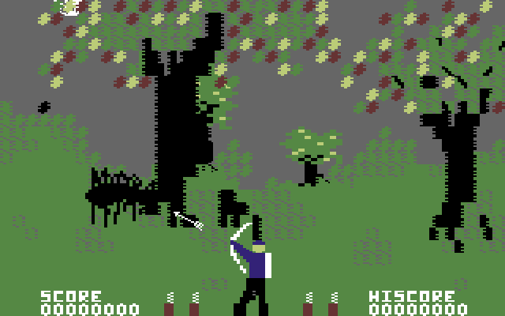

Certi giochi si ricordano per come si giocano. **Forbidden Forest** (Cosmi, 1983) si ricorda per come ti faceva sentire.

Su un modesto Commodore 64, **Paul Norman** costruì qualcosa che nessuno aveva mai visto: un bosco che respira, un cielo che passa dal giorno al crepuscolo alla notte stellata, sfondi in parallasse, ragni giganti, api, rane, draghi, un serpente, scheletri che emergono dal terreno e infine il Demogorgone, invisibile nel buio finché un lampo non lo rivela. Era cinematografico, violento e spaventoso sul serio, anni prima che qualcuno parlasse di "survival horror".

Questo progetto porta quel capolavoro su Amiga in tre edizioni: due puriste, fedeli fino all'ultimo pixel, e una rifatta, che ne reimmagina il mondo con una grafica nuova lasciandone intatta l'anima.

## Perché proprio questo gioco

Ho affrontato Forbidden Forest per ammirazione verso Paul Norman e la sua visione pionieristica.

Il suo vero talento è stato creare un'atmosfera impressionante e un impatto davvero cinematografico dentro i limiti di un hardware a 8 bit. Convertire questo gioco significa misurarsi con un'opera completa, dove ogni elemento serviva a un solo scopo: costruire tensione emotiva. Il ciclo dinamico giorno-notte, gli sfondi in parallasse e la violenza grafica esplicita vanno tutti in quella direzione.

Musica e sonoro hanno un ruolo fondamentale. Paul Norman li ha composti e lavorati di persona sul chip SID del C64. Conservarne fedelmente le musiche e gli effetti dinamici, come il ronzio minaccioso delle api, è l'omaggio più grande a un autore che ha trasformato un semplice videogioco in un'esperienza sensoriale indimenticabile.

## Fedeltà assoluta al codice sorgente

Il principio guida è lo stesso del porting di Wizard of Wor: **la logica originale non viene mai reinterpretata**.

Il codice 6502 originale è stato ricompilato staticamente in codice nativo 68000. È tradotto, non emulato: l'Amiga esegue il programma di Paul Norman, con gli stessi mostri, gli stessi schemi e gli stessi tempi, fino al ciclo di processore.

A dimostrarlo c'è una prova in parallelo: il codice ricompilato gira fianco a fianco con un C64 di riferimento, fotogramma dopo fotogramma, confrontando memoria, registri e cicli attraverso ogni mostro e ogni fase del gioco. Ogni routine è coperta.

Solo due cose sono state cambiate di proposito, e sono due comodità:

- La danza di fine ondata è più corta: circa 12 secondi invece di 28.
- Il suono della freccia a segno: l'effetto originale era debole, ed è stato sostituito da uno "splat" nuovo, ricavato filtrando il rumore del SID.

## Il suono autentico del SID

Musiche ed effetti sono il cuore dell'atmosfera di Forbidden Forest, quindi l'audio ha ricevuto la stessa cura del codice:

- **Registrato dal SID.** Le tre voci sono ricostruite da registrazioni del chip SID 6581 (reSID), con forme d'onda a banda limitata per timbri puliti e fedeli.
- **Suonato da Paula sull'A500.** Ogni voce del SID gira in ciclo su un canale hardware di Paula. La musica è alla sua altezza vera, non costa quasi niente al processore e non si interrompe nemmeno quando l'azione si fa fitta.
- **Mixato a 28 kHz sugli Amiga veloci.** Nelle edizioni più rapide le voci sono mixate via software ad alta qualità.

## Due anime: purista e rifatta

_L'edizione purista: la grafica di Paul Norman esattamente come l'ha disegnata, ora con lo scorrimento fluido._

**Forbidden Forest** (purista, A500) e **Forbidden Forest Fast** (purista, Amiga veloci):

- Grafica e giocabilità originali del C64, esattamente come Paul Norman le ha disegnate.
- Il bosco ora scorre fluido, invece dei salti di 8 pixel del C64.
- L'arciere è disegnato con gli sprite hardware dell'Amiga.

**Forbidden Forest Remake** (Amiga veloci, PiStorm):

- Grafica nuova a schermo pieno (368 × 256, senza bordi), nello stile di Another World.
- Tre piani in parallasse: il cielo, le colline lontane e il primo piano.
- Un cielo vivo: giorno, pomeriggio inoltrato, tramonto e notte, coi lampi che lo attraversano.
- La luna percorre il cielo dietro gli alberi e le nuvole. Al crepuscolo, e nell'ondata del Demogorgone, escono le stelle, fisse in cielo proprio come sul C64.
- L'arciere originale, con tutte le sue animazioni del C64, ricolorato per il mondo nuovo.
- I mostri si muovono dentro il bosco e passano dietro agli alberi e agli oggetti.
- Titoli d'apertura ridisegnati.
- Un pannello più chiaro: le frecce rimaste nella faretra e le vite accanto a un cuore rosso.

## Perché proprio questa versione

Paul Norman ha compresso un intero mondo cinematografico in 64 KB. Questo porting nasce dal desiderio di far risplendere quel mondo sull'Amiga: intatto nelle regole e nei tempi, più fluido nello scorrimento e, nella versione rifatta, vestito come la visione del 1983 avrebbe meritato, con gli strumenti di oggi.

Se ami i classici, o se ricordi la paura che faceva un bosco sul tuo C64, questa versione ti riporta dritto al 1983, con un tocco moderno.

> **Lo scarichi** dalla [pagina di Forbidden Forest](/giochi/forbidden-forest/): dischetto avviabile, pacchetti WHDLoad, purista e rifatta.
{: .prompt-info }

## Sostieni il progetto

Un porting di questo tipo richiede innumerevoli ore di ingegneria inversa, ricompilazione, prove sull'hardware vero e una passione genuina per la conservazione della storia videoludica.

Se il gioco ti è piaciuto e vuoi sostenere lo sviluppo di questo e dei prossimi progetti retro, pensa a una piccola donazione. Anche un contributo minimo aiuta a coprire i costi e a tenere acceso il motore per le prossime uscite.

Grazie di cuore per il supporto e… occhio ai ragni nel bosco!



---

*Gioco originale: Paul Norman, Cosmi, 1983. Conversione Amiga: Massimo Bonomo, 2026. Questo è un omaggio amatoriale; Forbidden Forest è © 1983 Cosmi / Paul Norman.*
