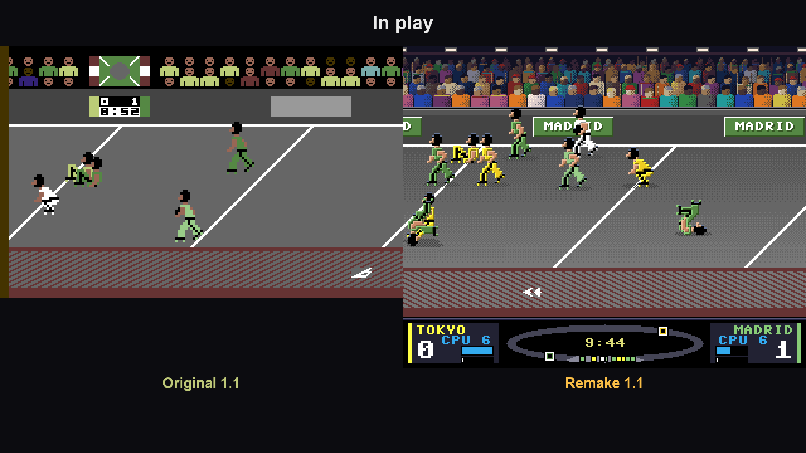

Nel 1975 *Rollerball* portò al cinema uno sport inventato e feroce: pattinatori che corrono su una pista inclinata dietro a una palla d'acciaio, e motociclisti che li trainano e li travolgono. Dieci anni dopo, **IJK Software** ne ricavò un gioco per Commodore 64.

Le recensioni dell'epoca furono buone — qualcuno lo definì *il migliore dei programmi IJK in circolazione* — ma una osservazione torna in più di una: **a differenza del film, nel gioco le moto non ci sono.**

Non per dimenticanza. Semplicemente, su un C64 non ci stavano.

## Perché proprio questo gioco

**Rocketball** è di **John Sinclair**, con le musiche di **Lawson Pilling**, pubblicato da IJK Software nel 1985 — qualche archivio riporta il 1984, e la cosa non è mai stata chiarita del tutto. In Italia arrivò in edicola col titolo **Roller Ball**.

Due squadre di cinque pattinatori, una palla d'acciaio, si segna scagliandola nella porta ricavata nel muro. E si ferma l'avversario con qualunque mezzo: gomitate e cariche. Una partita dura una decina di minuti.

L'ho scelto per due motivi.

Il primo è che è un gioco **cattivo**, nel senso buono. Nel 1985 quasi tutti i giochi sportivi erano simulazioni educate. Questo no: ti metteva in mano una squadra e ti lasciava decidere quanto fare male agli altri. La carica non era un fallo, era una tattica. E sotto quella violenza da film c'era un motore sorprendentemente solido, con cinque giocatori per squadra gestiti dal computer e una fisica della palla che regge ancora.

Il secondo è pratico, ed è quello che l'ha fatto scegliere per primo: è un gioco **leggero**. Un gioco leggero è il banco di prova ideale per un metodo di conversione nuovo, perché se qualcosa non torna te ne accorgi subito, senza doverlo cercare dentro un mostro da 64 KB saturi.

## Il primo gioco interamente costruito con reforge

Rocketball 2.0 è il primo titolo che esce **per intero** dal nuovo metodo, quello raccontato in [Dal SID a Paula](/posts/dal-sid-a-paula/).

Ogni edizione è ricostruita da zero: il gioco del C64 riscritto in C, routine per routine, e verificato contro un emulatore C64 a ogni fotogramma e a ogni ciclo di processore, con uno strato Amiga nuovo per schermo, suono e comandi. È tradotto, non emulato: l'Amiga esegue la logica di Sinclair, con le stesse regole, gli stessi tempi e gli stessi avversari.

Cosa se ne ricava, in concreto:

- una versione che su un **A500 di serie tiene la velocità del C64**: lo schermo disegna meno immagini al secondo, ma la partita non rallenta;
- gli **effetti sonori della palla**, che nella vecchia conversione 1.x erano andati persi;
- il telecronista in stereo e tutte le opzioni della versione rifatta funzionanti.

Due varianti: `rb` per 68020 e oltre — A1200, acceleratori, PiStorm — e `rb_a500` per un A500 di serie.

_L'edizione originale: la grafica del C64, la pista inclinata e la palla d'acciaio._

## Le moto, finalmente

La versione rifatta tiene come motore lo stesso gioco ricompilato e cambia quello che si vede e come si gioca. È l'esempio concreto di cosa significa poter modificare un gioco d'epoca scrivendo in C invece che in assembly: le moto non sono un rattoppo, sono codice nuovo appoggiato sopra il gioco originale tradotto.

Entrano in due modi, tutti e due presi dal film.

**Al calcio d'inizio.** Dopo un gol, due moto trainano in pista la squadra che l'ha subito, e la palla scende verso il primo pattinatore trainato.

**In partita, come potenziamento.** La barra di ogni squadra si riempie in due minuti di gioco. Quando è piena, tenendo premuto il fuoco arriva la tua moto: resta in pista dieci secondi e travolge ogni avversario a tiro, mai i compagni. Anche le squadre del computer chiamano la loro. Una moto alla volta.

**Il resto dell'aspetto.** Arena, pubblico, pattinatori e pannello ridisegnati a schermo pieno. Quattro squadre con i propri colori — Tokyo, Napoli, Madrid, Mosca — un telecronista che commenta in stereo e un pannello con il radar dell'intera pista.

**Le regole nuove.** La palla si prende al contatto e non più solo accucciandosi. Passaggi e tiri col fuoco più una direzione, passaggio automatico al compagno libero, scatto che consuma la resistenza della squadra, porte più larghe, rimbalzi sul muro, difesa a zona e portiere per le squadre del computer.

E qui la parte importante: **ogni regola nuova si può riportare a quella del C64** dalla pagina delle opzioni, una per una o tutte insieme. Chi vuole il gioco del 1985 lo ha intatto, moto comprese da spegnere.

## Perché proprio questa versione

Perché chiude una cosa rimasta aperta per quarant'anni.

I recensori del 1985 avevano ragione: mancava il pezzo più riconoscibile del film. Non si poteva fare, e il gioco restava comunque buono. Oggi si può, e si può farlo **senza toccare il gioco che era**: sotto gira sempre il codice di John Sinclair, verificato riga per riga, e le moto stanno in uno strato che si spegne con un'opzione.

È anche la dimostrazione che il metodo funziona fino in fondo: stesso codice verificato sotto, due facce sopra, e per la prima volta anche l'A500 di serie servito senza compromessi.

> **Lo scarichi** dalla [pagina di Rocketball](/giochi/rocketball/): dischetto avviabile, pacchetti WHDLoad, originale e rifatta.
{: .prompt-info }

## Sostieni il progetto

Un porting di questo tipo richiede innumerevoli ore di ingegneria inversa, ricompilazione, prove sull'hardware vero e una passione genuina per la conservazione della storia videoludica.

Se il gioco ti è piaciuto e vuoi sostenere lo sviluppo di questo e dei prossimi progetti retro, pensa a una piccola donazione. Anche un contributo minimo aiuta a coprire i costi e a tenere acceso il motore per le prossime uscite.

Grazie di cuore per il supporto e… attento alle moto.



---

*Rocketball, Commodore 64, © 1985 IJK Software: programma di John Sinclair, musiche di Lawson Pilling. Pubblicato in Italia come Roller Ball. Ispirato al film Rollerball (1975). Conversione Amiga e versione rifatta: Massimo Bonomo, 2026. Questo è un omaggio amatoriale; Rocketball è © 1985 IJK Software.*
