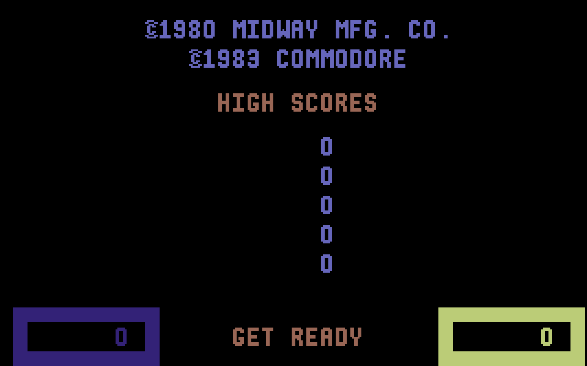
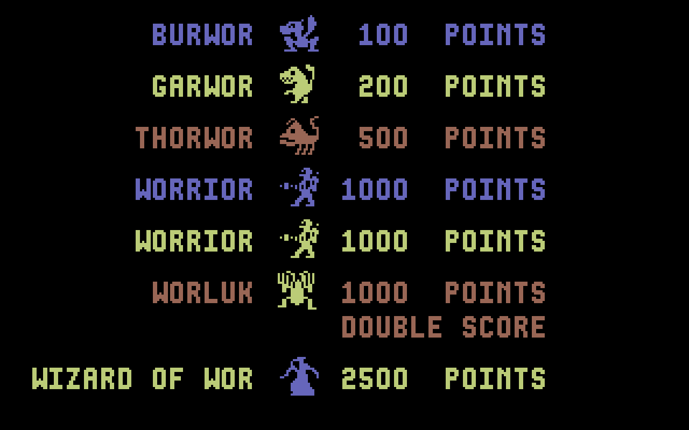

Quando si parla di leggende dell'arcade, **Wizard of Wor** occupa un posto speciale nel cuore di ogni retrogamer. Ma qual è davvero la versione migliore? In molti tendono a idolatrare il cabinato originale, che però — a guardarlo con occhio critico — soffre di una certa confusione visiva: colori disomogenei, fondali incoerenti e quelle stelle sullo sfondo che, diciamolo, sono piuttosto sgradevoli.

La versione per Commodore 64, al contrario, è frutto di una lavorazione meticolosa e di un'attenzione al dettaglio quasi maniacale. La tavolozza limitata ha imposto una pulizia grafica straordinaria, togliendo il rumore visivo e lasciando spazio a ciò che conta davvero: uno sfondo pulito e un gioco puro, equilibrato, coinvolgente.

Da queste premesse è nato il mio ultimo progetto: portare su Amiga la leggendaria versione C64 di Wizard of Wor, mantenendone intatto lo spirito originale e sfruttando le capacità della nuova piattaforma.

## Fedeltà assoluta al codice sorgente

Il principio guida di questo porting è stato rigido: **nessun compromesso sulla struttura di fondo**. Il lavoro è partito direttamente dal codice sorgente originale del Commodore 64, senza aggiungere una sola riga che potesse alterare la logica di gioco. L'obiettivo non era "reinterpretare", ma conservare esattamente l'esperienza che ha reso quel codice senza tempo, trasferendola su un'architettura più potente senza snaturarla.

## Audio autentico e la magia del Magic Voice

Uno degli aspetti più affascinanti dell'originale per C64 era il supporto alla rarissima cartuccia **Magic Voice**, che aggiungeva al gioco la sintesi vocale.

Per riprodurre e migliorare questa caratteristica senza introdurre ritardi o cali di fotogrammi dovuti a una pesante emulazione software, il motore audio è stato curato in ogni dettaglio:

- **Catture dirette dal SID.** I principali effetti sonori sono catture eseguite direttamente dal processore SID: precisione acustica assoluta, zero ritardo.
- **Ingegneria inversa del Magic Voice.** Sulla cartuccia Magic Voice è stata condotta un'ingegneria inversa completa, per estrarre e analizzare i file audio originali.
- **Atmosfera arricchita.** Usando i comandi vocali originali è stata integrata una voce naturale ma pacata, arricchita da un riverbero "da caverna" che amplifica l'atmosfera buia e sotterranea dei labirinti di Wor.

_La versione C64 sull'Amiga: fondo pulito e colori esattamente dove devono stare._

## Anche sul PC

Dall'8 novembre 2026 Wizard of Wor c'è anche per Windows, in tre edizioni: **C64**, **Magic Voice** e **Reforge**. Reforge è l'edizione con la voce del 2026 (sull'Amiga si chiama Voice 2026), e in più conserva i record da una partita all'altra. Si installa e si aggiorna con il [launcher Reforge Arcade](https://www.bonomo.cloud/launcher/).

Non è un emulatore. Il codice 6502 della cartuccia è tradotto in C con reforge, lo strumento che uso per questi porting, e confrontato con il C64. Poi è compilato per Windows sopra SDL3, la libreria che gli dà finestra, suono e comandi. In tutte e tre il SID viene emulato mentre il gioco gira; Magic Voice e Reforge aggiungono le stesse voci della versione Amiga, con i tempi del modulo vocale.

Si gioca in due sullo stesso computer, come al bar: il Worrior giallo con le frecce e la barra spaziale o con il primo gamepad, quello blu con W, A, S, D e il tasto Shift di sinistra o con il secondo gamepad.

_La galleria dei mostri con i loro punti, come la mostra il C64 fra una partita e l'altra._

Un limite da dire subito: il programma per PC non è firmato digitalmente, e Windows al primo avvio lo segnala.

## Perché proprio questa versione

Se gli autori dell'epoca avessero avuto a disposizione gli strumenti e la potenza di oggi, con ogni probabilità avrebbero spinto in questa direzione. Questo porting nasce dal desiderio di consegnare la versione più divertente, rifinita e giocabile di Wizard of Wor, costruita con passione artigiana e profondo rispetto per la storia del retrocomputing.

Se ami i classici e vuoi riscoprire un capolavoro liberato dai difetti visivi del cabinato, questa versione ti riporta dritto al 1983 — con un tocco moderno.

> **Lo scarichi** dalla [pagina di Wizard of Wor](/giochi/wizard-of-wor/):
> dischetti avviabili, pacchetti WHDLoad e le tre edizioni con le voci.
{: .prompt-info }

## Sostieni il progetto

Un porting di questo tipo richiede innumerevoli ore di ingegneria inversa, prove sull'hardware vero e una passione genuina per la conservazione dei videogiochi d'epoca.

Se il gioco ti è piaciuto e vuoi sostenere lo sviluppo di questo e dei prossimi progetti retro, pensa a una piccola donazione. Anche un contributo minimo aiuta a coprire i costi e a tenere acceso il motore per le prossime uscite.

Grazie di cuore per il supporto e… buona esplorazione dei sotterranei di Wor!



---

*Wizard of Wor: arcade Midway, 1981; cartuccia Commodore 64 di Commodore, 1983; modulo vocale Magic Voice, 1984. Conversione Amiga e PC: Massimo Bonomo, 2026. Questo è un omaggio amatoriale; Wizard of Wor è © dei rispettivi aventi diritto.*
