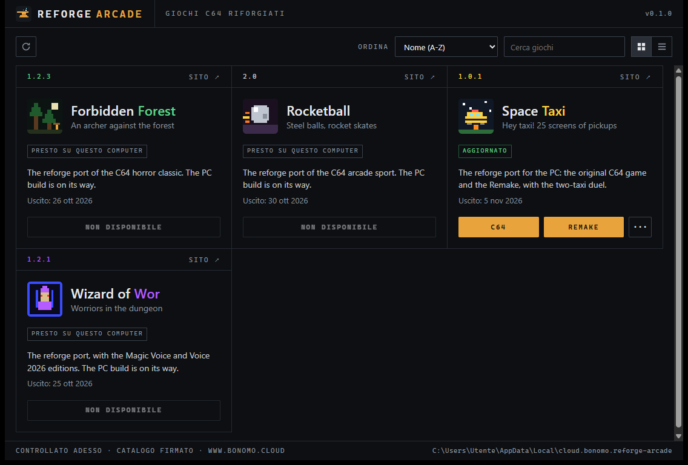
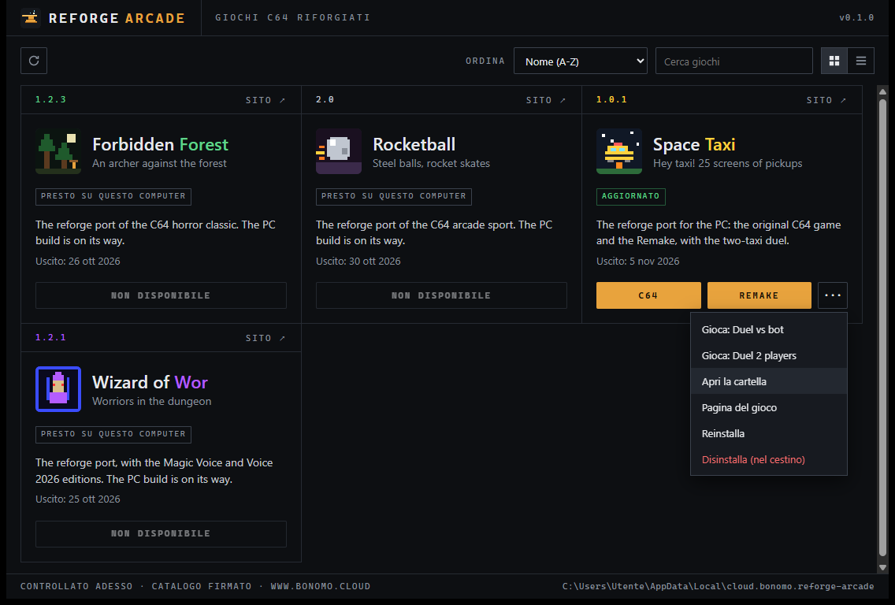
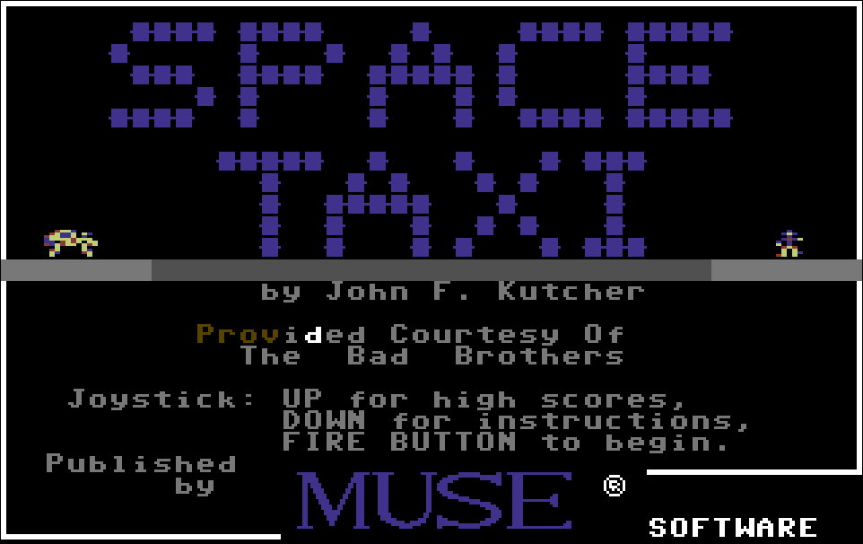

Per quarant'anni questi giochi hanno vissuto su un computer solo. Erano nati sul Commodore 64 e lì restavano: per rigiocarli servivano la macchina vera o un emulatore.

L'anno scorso ne ho portati quattro sull'Amiga, non emulandoli ma **traducendoli**: il codice 6502 riscritto in C, routine per routine, verificato contro l'emulatore a ogni fotogramma. Il metodo l'ho raccontato per esteso in [Dal SID a Paula](/posts/dal-sid-a-paula/).

Il punto di quel metodo è che il gioco, una volta tradotto, non è più legato a una macchina. Sotto c'è del C ordinario; quello che cambia da un computer all'altro è lo strato che gli disegna lo schermo, gli suona il suono e gli legge i comandi.

Oggi quello strato esiste anche per il PC. **Gli stessi giochi girano su Windows.**

> **Si scarica** dalla [pagina di Reforge Arcade](https://www.bonomo.cloud/launcher/): Windows 10 o 11 a 64 bit, circa 2,6 MB.
{: .prompt-info }

## Lo stesso codice, uno strato diverso

Al posto dello strato Amiga c'è uno strato PC costruito su **SDL3**: finestra ridimensionabile, schermo intero con F11, gamepad riconosciuto senza configurare niente.

Il gioco sotto è lo stesso. Non è una riscrittura per PC né un porting a parte: è lo stesso C verificato contro l'emulatore C64 che gira sull'Amiga. Le regole, i tempi e gli avversari sono quelli di allora, su entrambe le macchine.

## Perché serviva un launcher

Sull'Amiga un gioco si scarica, si copia e si lancia. Sul PC la stessa abitudine invecchia male: dopo tre giochi e due aggiornamenti non ricordi più quale versione hai, né dove l'hai messa.

Così i giochi PC non si scaricano a mano. Si prendono da **Reforge Arcade**, che fa tre cose e basta.

**Mostra i giochi come schede**, con versione, data di uscita e descrizione.

**Installa, con un clic.** Scegli il gioco, lui lo scarica e lo mette a posto.

**Aggiorna da solo**, sia i giochi sia se stesso. Quando esce una versione nuova compare *Aggiorna* sulla scheda; se è il launcher a essere vecchio, compare il dialogo *Aggiorna e riavvia*.

_Reforge Arcade. In basso la riga di stato dice quando ha controllato e che il catalogo è firmato._

## Quello che succede prima di scrivere un file

Un programma che scarica roba da internet e la installa da solo è esattamente il genere di cosa di cui diffidare. Ecco cosa fa prima di toccare il disco.

L'elenco dei giochi non è un file qualunque: è un **catalogo firmato** con una chiave ed25519, e di ogni file contiene l'impronta sha256. Il launcher verifica la firma del catalogo, scarica, ricalcola l'impronta del file ricevuto e la confronta.

Se il catalogo è stato alterato, o se il file che arriva non è quello che il catalogo descrive, **l'installazione non parte** e il gioco che hai già resta com'è. Non c'è un percorso in cui una verifica fallita porta comunque a scrivere qualcosa.

Due dettagli che contano quando li scopri tardi: aggiornando un gioco **i record restano** — la cartella `save/` non viene toccata — e la disinstallazione manda la cartella nel **cestino**, non la cancella.

## Una cosa che il certificato non copre

L'installer **non è firmato con un certificato di code signing**. Significa che Windows SmartScreen, la prima volta, può mostrare *«Windows ha protetto il PC»*: per proseguire bisogna scegliere *Ulteriori informazioni* e poi *Esegui comunque*.

Non è un allarme sul contenuto: è Windows che dice di non conoscere l'editore, e non lo conosce perché quel certificato costa un abbonamento annuale che per ora non ho preso. La garanzia sui giochi viene dall'altra parte, dalla firma del catalogo descritta qui sopra, e quella c'è già oggi.

Lo scrivo qui perché è meglio saperlo prima di vedere la finestra rossa.

## Il primo gioco è Space Taxi

Dentro il launcher, al momento, c'è **Space Taxi** — e ci sta in quattro modi.

L'**originale** del 1984, tradotto e verificato. Il **Remake**, con la grafica e il comportamento rifatti. Il **duello contro il computer**, con un secondo taxi guidato da un bot. E il **duello a due giocatori sullo stesso PC**: frecce e SPAZIO contro W A S D e SHIFT sinistro, oppure due gamepad.

Le modalità si scelgono dalla scheda: i due pulsanti grandi lanciano le versioni principali, il menu accanto apre le altre.

_Dallo stesso menu si apre la cartella del gioco, si reinstalla, o si disinstalla mandando tutto nel cestino._

Il gioco pesa circa 2,5 MB.

_La schermata del titolo come usciva nel 1984, in una finestra di Windows._

**Rocketball**, **Wizard of Wor** e **Forbidden Forest** sono già nel launcher, marcati *presto su questo computer*. Le loro versioni PC compariranno lì, pronte da installare, senza che ci sia niente da scaricare a mano.

Del launcher esiste anche una **versione per Mac**, che per ora è in prova. Arriverà: non dico quando, perché non lo so.

> **Reforge Arcade** si scarica dalla [sua pagina](https://www.bonomo.cloud/launcher/) — [download diretto](https://www.bonomo.cloud/launcher/Reforge-Arcade_x64-setup.exe), circa 2,6 MB. Le versioni Amiga restano dove sono, nella [sezione Giochi](/giochi/).
{: .prompt-info }

## Sostieni il progetto

Tradurre un gioco riga per riga, verificarlo contro l'emulatore e poi farlo girare su due macchine diverse richiede molte ore e una certa ostinazione.

Se ti è piaciuto e vuoi sostenere il lavoro, pensa a una piccola donazione: anche un contributo minimo aiuta a coprire i costi e a tenere acceso il motore per le prossime uscite.



---

*Space Taxi, Commodore 64, © 1984 Muse Software, programma di John F. Kutcher. Conversioni Amiga e PC, Remake e Reforge Arcade: Massimo Bonomo, 2026. Questo è un omaggio amatoriale; i giochi originali sono © dei rispettivi aventi diritto.*
