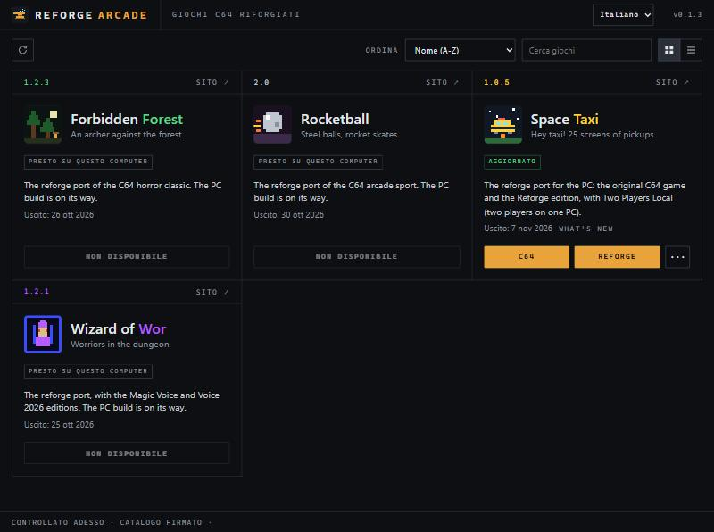
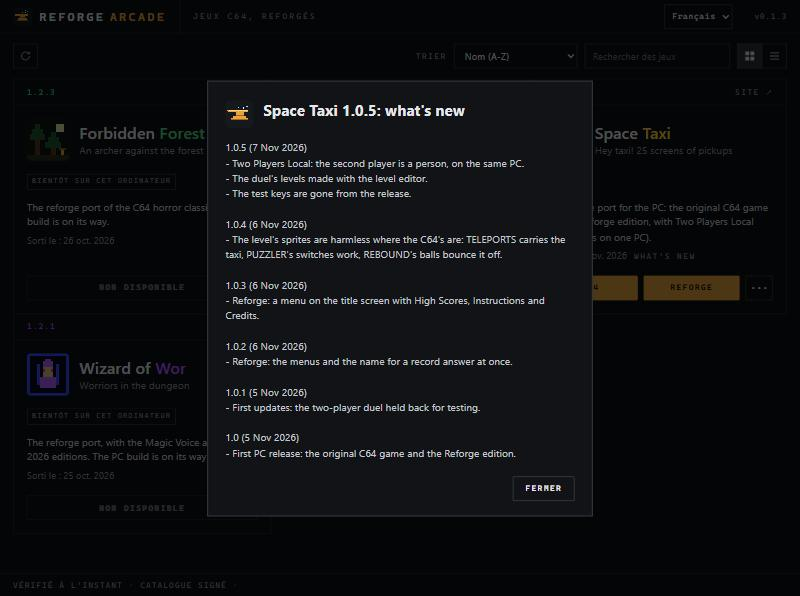

[Due giorni fa](/posts/reforge-arcade-pc/) ho scritto che sul PC i giochi arrivano con un posto dove stare, e che quel posto si aggiorna da solo. È comodo, ma è anche una richiesta di fiducia: un programma che scarica roba e la installa senza chiedere, in una lingua che non è la tua, è esattamente ciò di cui conviene diffidare.

La **0.1.3** restituisce due cose che quella fiducia la rendono meno cieca: la tua lingua, e la possibilità di vedere cosa sta per cambiare.

## Cinque lingue, e un confine dichiarato

L'interfaccia è tradotta in **cinque lingue**: inglese, italiano, tedesco, francese, spagnolo. Il selettore è in alto a destra. Con **Auto** segue la lingua del sistema, e ripiega sull'inglese se la lingua non c'è; la scelta resta memorizzata, quindi si fa una volta sola.

Quello che **non** è tradotto, in nessuna delle cinque: i testi del catalogo — nome, slogan e descrizione di ogni gioco — e il changelog. Restano in inglese.

_L'interfaccia in italiano. Dentro le schede, slogan e descrizioni restano in inglese: quello è il catalogo._

Non è una dimenticanza. Quei testi sono gli stessi che stanno sulle pagine dei giochi qui sul sito, che sono in inglese per scelta, e nascono dal `game.md` che ogni gioco si porta dietro: tradurli vorrebbe dire mantenerne cinque versioni a ogni rilascio, e vederle divergere. Meglio un confine netto e dichiarato che cinque traduzioni che invecchiano.

## Il limite, scritto qui e non scoperto dopo

**Tedesco, francese e spagnolo li ha tradotti Claude, e nessun madrelingua li ha riletti.**

Lo scrivo perché è vero e perché è il genere di cosa che chi apre il programma scopre comunque, al primo termine che suona storto — e a quel punto non crede più al resto. L'inglese e l'italiano li ho controllati io. Le altre tre lingue sono utilizzabili, ma se trovi una frase sbagliata segnalala: è il modo più rapido perché smetta di esserlo. Altre lingue, per ora, non ce ne sono.

## Vedere cosa cambia, prima di aggiornare

Ogni scheda ha un link **What's new**: apre l'elenco delle versioni di quel gioco, dalla più recente in giù. Per Space Taxi significa il percorso dalla 1.0 alla 1.0.5.

_Il confine si vede bene qui: l'interfaccia è in francese, il changelog resta in inglese._

È il complemento dell'aggiornamento automatico. Un programma che si aggiorna da solo dovrebbe anche saperti dire *cosa* ha cambiato, altrimenti l'automatismo è solo una cosa che succede. Accanto c'è **SITE**, che porta alla pagina del gioco qui sul sito — per Space Taxi, [questa](/giochi/space-taxi/), online da oggi.

## Se hai già il launcher

Non devi fare niente: chi ha la **0.1.1** o la **0.1.2** passa alla 0.1.3 da solo al primo avvio. Anche la **0.1.0**, quella dell'articolo di due giorni fa, ha già lo stesso meccanismo e dovrebbe aggiornarsi allo stesso modo — questo però non l'ho verificato su un'installazione vera, quindi se resta ferma basta riscaricarla.

Chi non ce l'ha lo scarica dalla pagina qui sotto. I giochi già installati restano dove sono, record compresi.

> **Reforge Arcade** si scarica dalla [sua pagina](https://www.bonomo.cloud/launcher/) — [download diretto](https://www.bonomo.cloud/launcher/Reforge-Arcade_x64-setup.exe), Windows 10 o 11 a 64 bit, circa 2,6 MB. Le versioni Amiga stanno nella [sezione Giochi](/giochi/).
{: .prompt-info }

Vale ancora quello che ho scritto l'altra volta sulla sicurezza: ogni gioco e ogni aggiornamento è verificato contro un catalogo firmato e contro l'impronta di ogni file, e l'installer non ha un certificato di code signing, quindi SmartScreen può fermarsi la prima volta. Il dettaglio è [nell'articolo precedente](/posts/reforge-arcade-pc/).

## Sostieni il progetto

Se i giochi ti piacciono e vuoi sostenere il lavoro, pensa a una piccola donazione: aiuta a coprire i costi e a tenere acceso il motore per le prossime uscite.



---

*Reforge Arcade e le conversioni: Massimo Bonomo, 2026. I giochi originali sono © dei rispettivi aventi diritto.*
