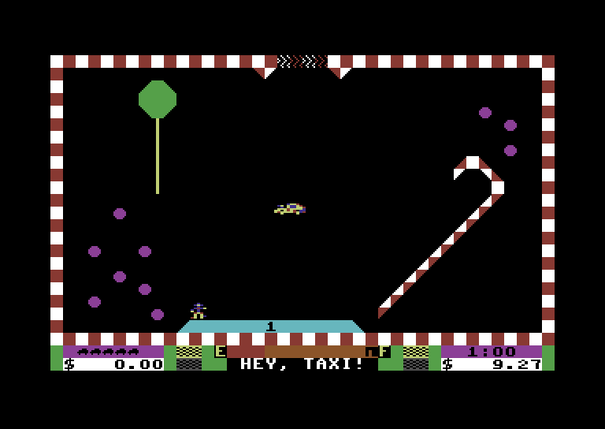
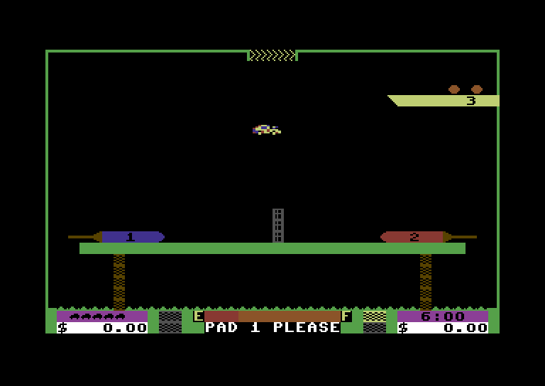
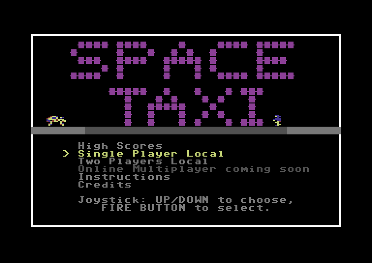
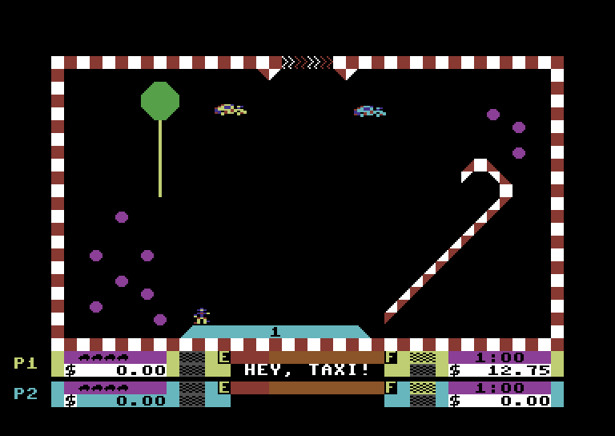

Chi ha avuto un Commodore 64 a metà degli anni Ottanta se lo ricorda per una frase: **«Hey taxi!»**.
La gridava un omino su una piazzola sospesa nel vuoto, con una voce umana, da una macchina che di voci
non ne sapeva niente.

_Il primo «Hey taxi!» della partita: il passeggero aspetta sulla piazzola 1, la scritta in basso ripete quello che dice._

**Space Taxi** lo scrisse John F. Kutcher e lo pubblicò la Muse Software nel 1984, la casa di Castle
Wolfenstein; la musica è di Silas Warner. Secondo un'intervista citata da Wikipedia, Kutcher lo
programmò da matricola alla Johns Hopkins University, e la fisica del taxi viene da Lunar Lander. Un
taxi che vola, un passeggero che chiama, una piazzola dove lasciarlo: venticinque schermate, ognuna con
la sua trovata, fra magneti, teletrasporti, una pallina da ping pong e un buco nero. Poi la gravità, il
carburante, e un atterraggio da fare con il carrello giù e piano.

_TAXI PONG: le piazzole 1 e 2 sono le racchette di un tavolo da ping pong, con la rete in mezzo._

## Una voce senza campionatore

Il C64 non aveva un convertitore per riprodurre suoni registrati. Aveva il SID, un sintetizzatore a
tre voci fatto per suonare note. Eppure Space Taxi parla: «Hey taxi!», «Pad one, please», «Up,
please», «Thanks», con voci di altezze diverse.

Come Kutcher le abbia registrate, le fonti non lo dicono allo stesso modo: secondo alcuni racconti con
un convertitore costruito da lui, secondo altri con il software vocale che Warner aveva scritto per la
Muse. Non ho trovato una fonte solida che chiuda la questione.

Come le **riproduce** il gioco, invece, l'ho visto nel codice, perché per convertirlo ho dovuto
leggerlo istruzione per istruzione. Le parole stanno in un file del disco, `TAXI/VOC`: quindici voci,
da un quarto di secondo a poco più di mezzo secondo ciascuna, in circa 7,5 KB. Non c'è un'onda da
suonare: ogni byte è un'attesa. Il programma aspetta quel numero di giri di un ciclo, poi inverte un
solo bit del registro del SID che decide quali voci passano dal filtro, legge il byte dopo e aspetta di
nuovo. La voce è un segnale a un bit, acceso e spento a tempo.

Che basti invertire quel bit per muovere l'uscita del chip, e quindi la membrana dell'altoparlante, è
una proprietà del SID del C64 che il gioco sfrutta, anche se questo non l'ho verificato su una macchina
vera. Quello che il codice mostra senza dubbi è il prezzo: mentre parla, il C64 non fa nient'altro.
Spegne le interruzioni, si fermano il gioco e la musica. Ogni «Hey taxi!» è mezzo secondo in cui il
mondo resta immobile.

## Estrarre una voce che non esiste

Su Amiga e su PC non c'è un registro del SID da accendere e spegnere: c'è un chip audio che vuole
campioni veri. E la voce di Space Taxi, come file, non esiste: esiste solo come sequenza di attese, e
il suo suono dipende dalla velocità esatta del processore che le conta.

Così ho ricostruito il segnale a un bit come lo produce il C64, contando i cicli del 6502 per ogni
attesa, e ne ho ricavato campioni veri: il segnale mediato sul tempo di ogni campione, a 11 kHz e 8
bit. Le quindici parole occupano 68 KB, si riconoscono e hanno il carattere un po' gracchiante
dell'originale. Le edizioni fedeli, **Fast** sull'Amiga e **C64** sul PC, si fermano per ogni parola
come il Commodore: la fedeltà comprende anche quel mezzo secondo di immobilità.

## Il gioco sul PC

La versione per PC non è un emulatore. È lo stesso codice del 6502 tradotto in C con reforge, lo
strumento che uso per questi porting, compilato per Windows sopra SDL3, la libreria che gli dà
finestra, suono e comandi. Il programma che gira sull'Amiga e quello che gira sul PC nascono dallo
stesso sorgente; cambia solo lo strato sotto.

Lo schermo è quello del C64. Il suono no, ed è la differenza più interessante: sull'Amiga la musica è
stata convertita una volta per tutte in flussi per il chip audio, mentre sul PC il SID viene emulato
mentre il gioco gira, registro per registro, al ciclo del C64 in cui il gioco lo scrive, filtro
compreso. Le voci, su tutte e due, sono i campioni ricostruiti.

Il ritmo è quello del Commodore, non quello del PC: ho confrontato la versione PC con una registrazione
del gioco originale, e la routine di gioco gira ogni due fotogrammi in tutte e due. Una partita va alla
stessa velocità di allora, su qualsiasi computer.

Si gioca con le frecce e la barra spaziale, oppure con un gamepad; P mette in pausa, e durante la
partita F2-F8 regolano il volume degli effetti e delle voci. Si scarica e si aggiorna con il
[launcher Reforge Arcade](/posts/reforge-arcade-pc/): per ora c'è solo la versione Windows a 64 bit.

## Che cosa ho cambiato

Il gioco è lo stesso: stesse 25 schermate, stessa fisica, stessi tempi. Le modifiche stanno in
un'edizione separata, **Reforge** (sull'Amiga si chiama Remake), uguale sulle due piattaforme:

- **voci nuove**: frasi intere («Hey, taxi!», «Pad five, please.», «Up, please!») dette da una voce
  nuova, a 28 kHz; e il gioco **non si ferma** mentre parlano;
- un **menu** sulla schermata del titolo, con record, istruzioni e crediti.

_Il menu dell'edizione Reforge. La voce del gioco online è in grigio: c'è il posto, non ancora il gioco._

E sul PC c'è una cosa che sull'Amiga non c'è ancora: **Two Players Local**. Due persone sullo stesso
computer, due taxi nella stessa schermata. Il primo giocatore usa le
frecce o il primo gamepad, il secondo W, A, S, D con il tasto Shift di sinistra, o il secondo gamepad.
Nel gioco del 1984 il duello non c'era: è scritto da zero sopra il codice originale, che resta intatto.
Alcune schermate pensate per un solo taxi, come TELEPORTS o PUZZLER, nel duello vengono saltate.

_Two Players Local sul PC: il taxi giallo del primo giocatore e quello azzurro del secondo, ognuno con i suoi strumenti in basso._

Il passo dopo è il gioco **online**: due giocatori su due computer, anche lontani. Oggi non c'è e non
si può giocare; nel menu la voce c'è ma è in grigio, e il cursore la salta. Il pezzo che sta su
internet esiste già: un servizio che fa incontrare i giocatori e uno che passa i dati della partita
dall'uno all'altro. Manca la parte dentro il gioco, quella che conta, e non ha ancora una data.

## I limiti, detti subito

Sull'Amiga serve almeno un 68020 con memoria Fast: su un A500 senza acceleratore non parte, e lo dice
con un messaggio invece di bloccarsi. Il gioco online, come detto, non c'è ancora. Il
programma per PC non è firmato digitalmente, e Windows al primo avvio lo segnala.

## Perché proprio Space Taxi

Perché nel 1984 quella voce era un trucco che funzionava solo su quella macchina, con quei tempi
esatti. Portarlo altrove senza perderlo voleva dire capirlo fino all'ultimo ciclo: non rifare il
gioco, ma tradurre quello che c'era, compresa una voce che non era mai stata un file.

> **Lo scarichi** dalla [pagina di Space Taxi](/giochi/space-taxi/):
> dischetto avviabile e pacchetti WHDLoad, con versione e peso di ogni file.
{: .prompt-info }

## Sostieni il progetto

Una conversione come questa nasce da molte ore di ingegneria inversa,
ricompilazione e prove sull'hardware vero. Se il gioco ti è piaciuto e
vuoi sostenere i prossimi progetti, pensa a una piccola donazione: anche
un contributo minimo aiuta a coprire i costi.



---

*Space Taxi: John F. Kutcher, Muse Software, 1984; musica di Silas S. Warner. Conversione Amiga e PC: Massimo Bonomo, 2026. Questo è un omaggio amatoriale; Space Taxi è © dei rispettivi aventi diritto.*
