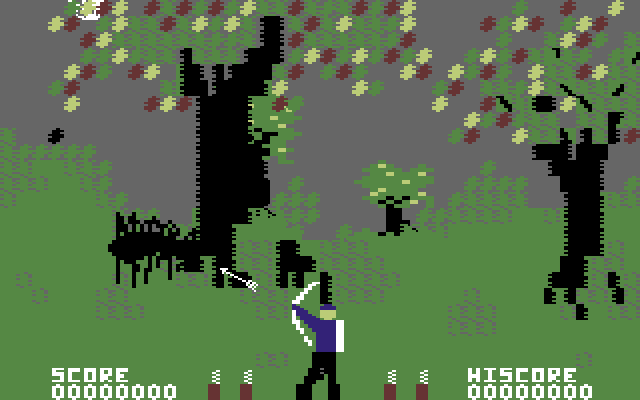

# `article.md`: l'articolo del gioco sul blog

Oggi ogni release allega `game.md` e `sync-giochi.py` ne ricava la **pagina**
del gioco sotto `/giochi/<slug>/`.

Questo documento definisce il secondo file, `article.md`, da cui lo stesso
script ricava l'**articolo** che compare in prima pagina sul blog: la storia
del gioco, perché è stato scelto, come è stato convertito.

Sono due cose diverse e non vanno confuse:

| | `game.md` | `article.md` |
|---|---|---|
| Produce | la pagina del gioco | l'articolo sul blog |
| Dove finisce | `/giochi/<slug>/` | `/posts/<slug>/` e in home |
| Contenuto | che cos'è, requisiti, comandi, download | racconto, storia, scelte |
| Lingua | inglese | **italiano** |
| Cambia | a ogni versione | di rado |

## Dove si mette

Allegato alla release su GitHub, accanto a `game.md`, con il nome esatto
`article.md`. Lo script lo cerca fra gli allegati dell'ultima release: se non
c'è, non succede niente e l'articolo semplicemente non viene creato o
aggiornato.

## Formato

Front matter YAML, poi il corpo in Markdown.

```markdown
---
titolo: "Wizard of Wor su Amiga: il porting definitivo della versione Commodore 64"
sommario: >-
  Perché la versione C64 batte il cabinato arcade, e come è arrivata su Amiga
  con la voce del Magic Voice ricostruita per ingegneria inversa.
copertina: wizard_of_wor_amiga_3_dungeon.png
tag: [magic-voice, porting]
crediti: >-
  Wizard of Wor: arcade Midway, 1981; cartuccia Commodore 64 di Commodore,
  1983; modulo vocale Magic Voice, 1984. Conversione Amiga: Massimo Bonomo,
  2026. Questo è un omaggio amatoriale; Wizard of Wor è © dei rispettivi
  aventi diritto.
---

Quando si parla di leggende dell'arcade, **Wizard of Wor** occupa un posto
speciale...

## Fedeltà assoluta al codice sorgente

...
```

### I campi

| Campo | Obbligatorio | A cosa serve |
|---|---|---|
| `titolo` | sì | Titolo dell'articolo. Non ripetere il solo nome del gioco: dica anche *perché* vale la pena leggerlo. |
| `sommario` | sì | Due righe sotto il titolo, e testo che compare quando il link viene condiviso. |
| `copertina` | no | Nome di una cattura già pubblicata in `assets/img/giochi/<slug>/`. Senza, si usa la prima. |
| `copertina_alt` | no | Che cosa si vede nella copertina, per chi non vede l'immagine. Senza, lo script avvisa e ripiega sul titolo, che è una descrizione debole. |
| `tag` | no | Tag aggiuntivi. Quelli fissi li mette lo script. |
| `crediti` | sì | Riga finale in corsivo: autori originali, anno, editore, e che si tratta di un omaggio amatoriale. |

## Che cosa aggiunge lo script da solo

Nel corpo **non** vanno messe queste cose, perché le genera `sync-giochi.py`:

- il front matter Jekyll (`date` dalla data della release, `categories: [Giochi, Amiga]`,
  i tag fissi `amiga, c64, <slug>, reforge, retrogaming`, `image` dalla copertina);
- il richiamo al download, cioè il riquadro che rimanda a `/giochi/<slug>/`;
- il blocco **Sostieni il progetto** con il pulsante PayPal (``);
- la riga dei crediti in coda, presa da `crediti`.

Il corpo contiene solo il racconto: paragrafi, sottotitoli `##`, elenchi,
immagini. Nient'altro.

## Le immagini nel corpo

Si richiamano con il percorso pubblico delle catture già caricate:

```markdown

_L'edizione purista: la grafica di Paul Norman come l'ha disegnata._
```

La riga in corsivo subito sotto diventa la didascalia (è una convenzione del
tema Chirpy). Il testo fra parentesi quadre è la descrizione per chi non vede
l'immagine: scrivere che cosa si vede, non ripetere il titolo.

## Come si costruisce l'articolo

Un articolo nasce da **due fonti diverse**, e il mestiere sta nel legarle.

### 1. La storia: si cerca in rete

Il gioco originale ha una storia che non sta nei nostri file. Va cercata, e
vanno trovate almeno:

- **autore, editore, anno.** Il nome di chi l'ha programmato, non solo la
  casa editrice. Chi ha fatto le musiche, se risulta.
- **il titolo italiano,** se in Italia uscì con un altro nome.
- **che cosa ne dissero all'epoca.** Le recensioni dei mesi dopo l'uscita
  sono una miniera: dicono che cosa colpiva e che cosa mancava, con le parole
  di chi non sapeva ancora come sarebbe finita.
- **da dove veniva l'idea.** Un film, un cabinato, un gioco precedente.

Fonti utili: Wikipedia, C64-Wiki, MobyGames, GameBase64, gli archivi di
riviste dell'epoca.

### 2. Le novità: stanno nelle note di rilascio

Che cosa questa versione fa e la precedente no. Numeri misurati, non
impressioni. Le trovi nei `CHANGES.txt` delle release e nelle note di lavoro.

### 3. Il filo: si trova, non si inventa

Qui sta la differenza fra un articolo e una scheda tecnica. Il filo è la
frase che spiega **perché proprio quel gioco e perché proprio ora**, e di
solito nasce dall'attrito fra le due fonti: qualcosa che nel passato era un
limite e che oggi non lo è più.

Due esempi già scritti:

- **Rocketball.** Le recensioni del 1985 notavano che le moto del film non
  c'erano. Non ci stavano su un C64. La versione rifatta le mette, senza
  toccare il gioco che era. L'articolo è tutto lì dentro.
- **Space Taxi.** Il C64 non aveva un campionatore, eppure parlava, perché
  l'autore usò il registro del volume del SID come convertitore. Convertirlo
  significa estrarre una voce che **non esiste come file**.

Se il filo non si trova, l'articolo diventa un elenco di caratteristiche: si
legge una volta e non si ricorda.

### Che cosa non si fa mai

- **Non si scrive un dato non misurato.** "circa 12 secondi invece di 28"
  vale più di "molto più veloce". Se il numero non c'è, si dice a parole
  quello che si è osservato.
- **Non si nascondono i limiti.** Se sull'A500 il gioco è lento, si scrive.
  Chi scarica se ne accorge comunque, e a quel punto non crede più al resto.
- **Si segnala quando una fonte è debole.** "secondo i racconti dell'epoca" è
  una formula onesta per ciò che viene da un blog di appassionati e non da
  una fonte solida. Se due fonti sono in disaccordo su una data, si dice.
- **Non si riscrive la pagina del gioco.** Requisiti, comandi ed elenco dei
  file stanno in `game.md`. Qui si racconta.

## Come deve essere scritto

Gli articoli già pubblicati sono il riferimento:

- [Wizard of Wor](../_posts/2026-11-04-wizard-of-wor-amiga.md)
- [Forbidden Forest](../_posts/2026-11-04-forbidden-forest-amiga.md)

In breve:

- **In italiano.** Le pagine dei giochi sono in inglese, gli articoli no: il
  blog è italiano e i lettori stranieri usano la traduzione del browser.
- **Prima persona.** È il racconto di chi ha fatto il lavoro.
- **Si parte dal gioco, non dalla tecnica.** Perché quel gioco merita, che
  cosa aveva di speciale nel 1983, chi lo ha scritto. La tecnica viene dopo e
  serve a spiegare come quella qualità è stata conservata.
- **I numeri verificati, non gli aggettivi.** "circa 12 secondi invece di 28"
  vale più di "molto più veloce". Se un dato non è stato misurato, non si
  scrive.
- **Si dice anche cosa è stato cambiato.** Le due modifiche dichiarate in
  Forbidden Forest valgono più di mille promesse di fedeltà.
- **Niente superlativi di mestiere.** Non "rivoluzionario", non "definitivo"
  se non è argomentato.

Lunghezza indicativa: 600-900 parole. Chi vuole i dettagli tecnici ha la
pagina del gioco e il changelog.

## Quando l'articolo cambia

Lo script riscrive il post solo se il risultato è diverso da quello che c'è
già, cioè in pratica solo se `article.md` è cambiato. La data resta quella
della prima pubblicazione — la legge dal post esistente, non dalla release —
così l'articolo non risale in cima alla home a ogni correzione di versione, e
l'indirizzo non cambia.

Il post generato porta in testa una riga che lo dice:

```
# scritto da sync-giochi.py da article.md: le modifiche si fanno li'
```

Un post che **non** ha quella riga è stato scritto a mano, e lo script si
rifiuta di sovrascriverlo: lo segnala e passa avanti. Per sostituirlo con
quello che dice `article.md` serve dirlo esplicitamente:

```
python tools/sync-giochi.py --scrivi --riscrivi-articoli
```

Vale una volta sola per ogni gioco: i quattro articoli oggi pubblicati sono
scritti a mano, quindi la prima volta il loro testo va prima portato dentro
`article.md`, altrimenti si perde quello che non ci sta.
